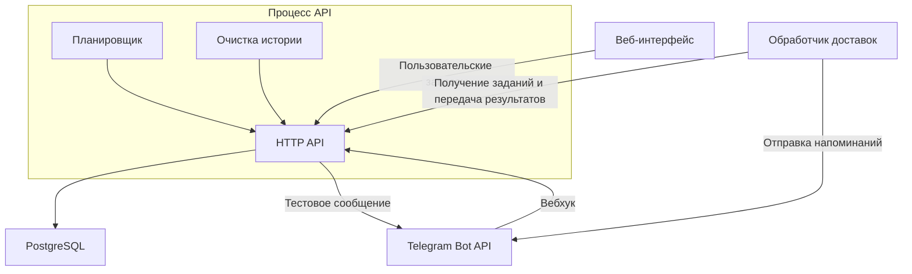

# Архитектура K.Alert

Документ описывает архитектуру первой версии. Пользовательские сценарии и правила доступа описаны в [требованиях](02-requirements.md).

## Компоненты

| Компонент | Ответственность |
| --- | --- |
| Веб-интерфейс | Формы регистрации и входа, управление командами, участниками, каналами и напоминаниями, просмотр истории доставок. |
| HTTP API | Пользовательские и служебные запросы, проверка прав, выполнение сценариев, выдача заданий и сохранение результатов. Только API напрямую обращается к PostgreSQL. |
| Планировщик | Таймер внутри API. Периодически запускает обработку наступивших сроков напоминаний. |
| Очистка истории | Таймер внутри API. Периодически запускает удаление завершённой истории по истечении срока хранения. Незавершённые и заблокированные доставки сохраняются. |
| Обработчик доставок | Отдельное приложение. Получает через API задания, отправляет сообщения в Telegram и передаёт результаты обратно. |
| PostgreSQL | Хранит пользователей, команды, настройки каналов, расписания, срабатывания и задания доставки. |

Веб-интерфейс отвечает за формы, навигацию и отображение результатов. Проверка прав, вычисление ближайшего срабатывания и переходы между состояниями выполняются на сервере. Например, после изменения расписания интерфейс показывает время, возвращённое API.

## Пользовательские сеансы и HTTP-контракты

Веб-версия использует серверные сеансы `UserSession` в общей PostgreSQL. Любой экземпляр API проверяет сеанс при каждом защищённом запросе. В браузере хранится случайный секретный токен в cookie с `HttpOnly`, `Secure`, `SameSite=Lax`; БД хранит только его хеш. Идентификатор записи `UserSession.Id` сам по себе не даёт доступа.

Вход и регистрация создают новый сеанс. Повторный вход отзывает предыдущий сеанс текущего браузера. Выход отзывает только текущий сеанс и удаляет cookie. Срок действия — 7 дней с момента входа без автоматического продления. Запросы, изменяющие данные, защищены от CSRF. Используется стандартный ASP.NET Core Antiforgery. Cookie сеанса называется `__Host-kalert-session`, служебная cookie — `__Host-kalert-csrf` (`HttpOnly`, `Secure`, `SameSite=Strict`). У обеих `Path=/`, атрибут `Domain` не задаётся. Интерфейс и API размещаются на одном origin.

При открытии приложения фронтенд получает проверочный токен через `GET /api/v1/auth/csrf` и хранит его в памяти. API устанавливает служебную cookie Antiforgery, токен для заголовка возвращает в JSON; ответ не кешируется. Фронтенд передаёт `X-CSRF-Token` во всех пользовательских `POST`, `PATCH`, `PUT`, `DELETE`, включая регистрацию, вход и выход. После успешной регистрации, входа и выхода токен запрашивается заново. При ошибке CSRF действие не выполняется, API возвращает `403 csrf_validation_failed` в общем формате.

Экземпляры API используют общие ключи Antiforgery, сохраняющиеся при перезапуске. Пользовательская CSRF-проверка не применяется к вебхуку Telegram и служебному API обработчиков, для которых используются отдельные механизмы проверки. GET-запросы не изменяют бизнес-данные.

Ежедневная очистка удаляет истёкшие и отозванные сеансы независимо от срока хранения истории доставок. Пользовательская cookie-авторизация не определяет служебную HTTP-авторизацию обработчиков доставок.

Форматы JSON и согласованные публичные методы приведены в [контрактах API](05-api-contracts.md). Успех без результата возвращает `204 No Content` без тела; ошибка такой операции возвращается с соответствующим HTTP-статусом и общим JSON ошибки.

## От сохранения напоминания до доставки

1. **Сохранение.** API проверяет участие пользователя в команде, корректность расписания и наличие активного канала. Сохраняет напоминание и время ближайшего срабатывания.
2. **Обработка наступившего срока.** Таймер вызывает сценарий планирования. Backend координирует обработку одного напоминания между экземплярами API через PostgreSQL и повторно проверяет, что срок наступил. Пара «напоминание и запланированное время» определяет уникальное срабатывание.
3. **Постановка заданий.** В одной транзакции Backend записывает срабатывание, создаёт по заданию на каждый активный канал и сохраняет следующий срок по расписанию. Разовое или исчерпанное расписание завершается. Если активных каналов нет, Backend фиксирует в истории «Пропущено — нет активных каналов» и обрабатывает расписание по тому же правилу.
4. **Отправка и результат.** Обработчик получает задания через служебный HTTP API, отправляет сообщения и передаёт результат по каждому чату. Веб-интерфейс показывает историю, полученную от API.

До фиксации транзакции сбой оставляет прежний ближайший срок, поэтому Backend может повторить обработку. После фиксации срабатывание и задания доступны в БД, даже если экземпляр API сразу остановился.

### Пропущенные сроки

После сбоя Backend обрабатывает каждое пропущенное срабатывание действовавшего расписания, начиная с самого раннего срока. Следующий срок рассчитывается от расписания, поэтому задержка доставки не сдвигает последующие даты. Для каждого срабатывания история хранит исходное запланированное время и время подтверждения доставки по каждому чату.

Каналы выбираются по состоянию на момент создания заданий. Например, если исходный чат отключили до обработки пропущенного срока, Backend не создаёт для него новое задание. Текст сообщения фиксируется при срабатывании, а назначение — при создании задания.

## Захват и повторные попытки

1. Обработчик запрашивает задания по служебной HTTP-авторизации. API атомарно переводит выданное задание в `Processing`, задаёт срок захвата `LeaseUntil` и возвращает токен `ClaimToken`.
2. Пока захват действует, задание закреплено за получившим его обработчиком. Если обработчик остановился до отправки, после истечения захвата API может выдать задание повторно с новым токеном.
3. Обработчик отправляет сообщение с сохранённым текстом и назначением. При передаче результата API проверяет токен захвата. Результат более ранней попытки не перезаписывает состояние нового захвата.

| Результат попытки | Действие |
| --- | --- |
| Telegram подтвердил отправку | API сохраняет успешный результат и время подтверждения. |
| Временная ошибка | API назначает следующую попытку для этого чата. Успешные доставки в другие чаты уже завершены. |
| Бот потерял возможность писать в чат | Доставка требует вмешательства. После восстановления доступа владелец может её возобновить. |
| Telegram подтвердил отправку, а API временно недоступен | Обработчик повторяет передачу результата. Если сохранить его не удалось и задание выдали повторно, возможен дубликат сообщения. |

## Подключение Telegram-чата

1. API создаёт временный запрос, привязанный к команде и владельцу, и возвращает одноразовую ссылку с параметром `startgroup`. Когда пользователь выбирает группу, Telegram передаёт боту команду с кодом из ссылки. [Документация по ссылкам для групп](https://core.telegram.org/bots/features#deep-linking)
2. Telegram отправляет событие на HTTPS-адрес вебхука API. API проверяет секретный заголовок, находит действующий запрос по коду и сохраняет идентификатор и название группы. Повтор события не создаёт новое подключение. [Документация Telegram Bot API](https://core.telegram.org/bots/api#setwebhook)
3. Владелец проверяет группу в интерфейсе и подтверждает подключение. API повторно проверяет права владельца и сам отправляет тестовое сообщение. Канал активируется после подтверждения отправки от Telegram. При ошибке владелец может исправить настройки чата и повторить проверку.

## Структура кода

Состав и прямые зависимости проектов соответствуют [решению в ветке develop](https://github.com/Code-Brew-Git-Hub/K.Alert/blob/develop/backend/ReminderService.sln). Ответственность в таблице описывает целевую архитектуру.

| Проект | Ответственность | Прямые зависимости внутри решения |
| --- | --- | --- |
| `Domain` | Предметные модели и допустимые изменения их состояния. | — |
| `Application` | Сценарии сервиса, вычисление расписания, интерфейсы доступа к данным и границы транзакций. | `Domain` |
| `Infrastructure` | Доступ к PostgreSQL, запросы с блокировками, транзакции и миграции. | `Application`, `Domain` |
| `Contracts` | Форматы запросов и ответов служебного HTTP API. | — |
| `Api` | HTTP, проверка прав, таймеры, вебхук и проверка подключения Telegram-чата. | `Application`, `Infrastructure`, `Contracts` |
| `DeliveryWorker` | Получение заданий, отправка напоминаний и передача результатов. | `Contracts` |
| `UnitTests` | Модульные тесты. Текущий проект тестов подключает `Domain`. | `Domain` |

## Развёртывание и отказы

Пример развёртывания включает два экземпляра HTTP API, несколько обработчиков доставок и общую PostgreSQL. Пользовательские запросы и вебхук отправляются на публичные HTTPS-адреса, за которыми балансировщик выбирает доступный экземпляр API. Обработчики обращаются к внутреннему адресу API и могут получать задания через любой работающий экземпляр.

Таймеры работают внутри каждого экземпляра API. Экземпляры координируют обработку сроков через общую БД. Каждый проход очистки обрабатывает только завершённую историю с истёкшим сроком хранения.

| Сбой | Поведение |
| --- | --- |
| Недоступен один экземпляр API | Другой принимает запросы интерфейса, Telegram и обработчиков. Его таймеры продолжают планирование и очистку. |
| Недоступны все экземпляры API | Интерфейс теряет доступ к данным. Планирование и выдача новых заданий приостанавливаются. Обработчики могут завершить начатую отправку и повторить передачу результата после восстановления API, если результат сохранился у обработчика. |
| Недоступна PostgreSQL | Операции с данными приостанавливаются. После восстановления API продолжает обработку с сохранённого состояния. |
| Недоступны все обработчики | API продолжает создавать задания. Они остаются в БД и будут выданы после запуска обработчиков. |

Конкретное размещение компонентов и резервирование PostgreSQL определяются при настройке окружения.

## Параметры доставки и очистки

Захват задания действует 5 минут с момента выдачи. Тайм-аут запроса отправки составляет 1 минуту. Обработчик начинает отправку, когда до истечения захвата остаётся достаточно времени для запроса и сохранения результата. После успешной отправки при недоступности API он повторяет сохранение результата, пока захват действует. Истёкший захват позволяет повторную выдачу с новым `ClaimToken`, результат прежнего захвата отклоняется.

Интервалы повторов после временных ошибок составляют 1, 5, 15, 30 и 60 минут, затем 60 минут для каждой следующей попытки. Каждый интервал отсчитывается от завершения неудачной попытки. Попытки продолжаются до успеха, отмены или ошибки, требующей вмешательства. Интервалы, срок захвата и тайм-аут отправки задаются конфигурацией.

Очистка запускается раз в сутки. Срабатывание удаляется вместе с доставками спустя 90 дней после завершения последней доставки, если все доставки имеют статусы `Sent` или `Cancelled`. При наличии незавершённых или заблокированных доставок история сохраняется. Срабатывание без доставок, пропущенное из-за отсутствия активных каналов, удаляется через 90 дней после создания.

## Состояние подключения Telegram-чата

Одноразовая ссылка действует 15 минут с момента создания. Выбор закрепляет за запросом один чат. Подтверждение владельцем и повторные тестовые отправки при ошибке возможны в пределах этого срока. Успешное подключение помечает запрос использованным. Для выбора другого чата создаётся новая ссылка.

Состояние запроса хранится в PostgreSQL в `TelegramChatConnectionRequest`, доступном всем экземплярам API, и переживает перезапуск одного экземпляра.

Подтверждения одного запроса выполняются последовательно с координацией через PostgreSQL между всеми экземплярами API. Backend проверяет инициатора и текущую роль владельца. Для уже завершённого запроса возвращает сохранённый `ChannelId`. Для незавершённого проверяет срок действия и выбранный чат, выполняет тестовую отправку, затем в одной транзакции создаёт канал и записывает `CompletedAt` и `ChannelId`. Внешняя отправка и транзакция фиксации результата являются отдельными этапами.

При параллельном подключении одного чата к одной команде ограничение уникальности неудалённых каналов предотвращает создание второй записи. Запросы могут завершиться ссылкой на один канал. Сбой после тестовой отправки и до фиксации результата допускает повторное тестовое сообщение при повторном подтверждении.

Завершённые запросы доступны ещё 24 часа после `CompletedAt`, истёкшие незавершённые — 24 часа после `ExpiresAt`. После этого ежедневная очистка может удалить запрос. Подключённый канал продолжает работать.

## Требования к расчёту календарных дат

Календарные правила определены в [требованиях](02-requirements.md#календарные-правила). При переводе часов назад одно местное время даёт одно срабатывание при первом наступлении. Ранее рассмотренная реализация и тесты ожидали два UTC-момента для такого времени. При реализации согласованного поведения нужно привести расчёт и тесты к правилу одного срабатывания.
