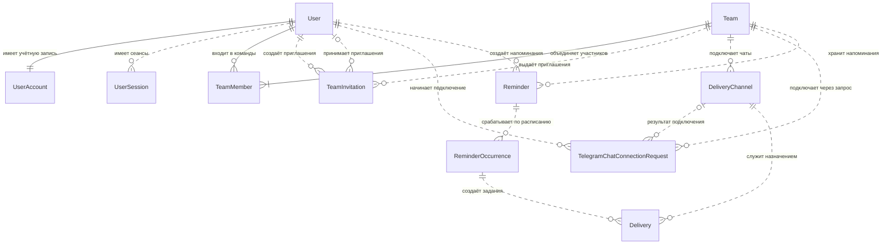

# Модель данных K.Alert

Модель первой версии опирается на [требования](02-requirements.md) и [архитектуру](03-architecture.md). Доменные имена и поля соответствуют [моделям в ветке develop](https://github.com/Code-Brew-Git-Hub/K.Alert/tree/develop/backend/src/ReminderService.Domain/Entities). Таблицы ниже описывают целевые типы PostgreSQL и ограничения. `UserAccount` добавляется для самостоятельной регистрации и входа, `UserSession` — для серверных сеансов веб-версии. Это целевая модель, наличие таблицы в документе не означает готовую реализацию.

## Сущности и связи

**Обозначения под схемой**

- `||` — ровно одна запись.
- `|o` слева или `o|` справа — ноль или одна запись.
- `o{` справа или `}o` слева — ноль или больше записей. Кружок означает, что связанных записей может не быть, «лапка» означает множество.
- `|{` справа или `}|` слева — одна или больше записей. Черта означает, что хотя бы одна запись обязательна.
- `--` — сплошная линия. Внешний ключ входит в первичный ключ дочерней записи.
- `..` — пунктирная линия. Внешний ключ хранится отдельно от первичного ключа дочерней записи. Обязательность связи показывает знак на конце линии.

Например, `ReminderOccurrence ||..o{ Delivery` означает, что у срабатывания может быть ноль или несколько доставок, а каждая доставка относится ровно к одному срабатыванию.

В таблицах `PK` означает первичный ключ, `FK` — внешний ключ, `UNIQUE` — ограничение уникальности. `NULL` разрешает отсутствие значения, `NOT NULL` требует его заполнить.

## Формат секретных токенов

Для `UserSession.TokenHash`, `TeamInvitation.TokenHash` и `TelegramChatConnectionRequest.TokenHash` независимо генерируется секрет из 32 криптографически случайных байтов. Передаваемая строка — 43 символа Base64url без `=`, с учётом регистра. Разрешены `A–Z`, `a–z`, `0–9`, `_`, `-`; пробелы не допускаются и не удаляются. В каждой таблице сохраняется только хеш. Сроки действия и правила использования определяются соответствующей моделью.

API проверяет длину, символы и декодирование в 32 байта. Стандартные CSRF-токены Antiforgery не подчиняются этому формату.

## User

| Поле | Тип PostgreSQL | Ограничения | Назначение |
| --- | --- | --- | --- |
| `Id` | `uuid` | PK | Идентификатор пользователя. |
| `DisplayName` | `text` | NOT NULL | От 1 до 100 символов после удаления пробелов по краям. Только печатные символы, без переносов строк и управляющих символов; не обязано быть уникальным. |
| `CreatedAt` | `timestamptz` | NOT NULL | Время создания профиля. |

## UserAccount

| Поле | Тип PostgreSQL | Ограничения | Назначение |
| --- | --- | --- | --- |
| `UserId` | `uuid` | PK, FK → `User.Id` | Идентификатор профиля и учётной записи. |
| `Email` | `text` | NOT NULL, UNIQUE | Один корректный адрес без отображаемого имени, до 254 символов после удаления пробелов по краям. Поиск и уникальность не учитывают регистр. |
| `PasswordHash` | `text` | NOT NULL | Хеш пароля, рассчитанный специализированным алгоритмом хеширования паролей. |

При регистрации и входе пробелы по краям email удаляются. Точки и часть после `+` сохраняются; внутренние пробелы отображаемого имени сохраняются. Точные правила приведены в [контрактах API](05-api-contracts.md#проверка-имени-email-и-секретных-токенов).

При регистрации Backend создаёт профиль и учётную запись в одной транзакции. Отображаемое имя для списка участников берётся из профиля. Уникальность адреса обеспечивает PostgreSQL, в том числе при параллельной регистрации.

## UserSession

| Поле | Тип PostgreSQL | Ограничения | Назначение |
| --- | --- | --- | --- |
| `Id` | `uuid` | PK | Идентификатор записи сеанса. |
| `UserId` | `uuid` | NOT NULL, FK → `User.Id` | Пользователь сеанса. |
| `TokenHash` | `text` | NOT NULL, UNIQUE | Хеш секретного токена из cookie. |
| `CreatedAt` | `timestamptz` | NOT NULL | Время создания сеанса. |
| `ExpiresAt` | `timestamptz` | NOT NULL | Через 7 дней после создания. |
| `RevokedAt` | `timestamptz` | NULL | Время отзыва сеанса. |

Cookie содержит случайный секретный токен, БД — только его хеш. `Id` записи не является секретным токеном доступа. Сеанс действителен, если `RevokedAt IS NULL` и текущее время строго меньше `ExpiresAt`. API проверяет это при каждом защищённом запросе.

Вход и регистрация создают новый сеанс. Повторный вход отзывает прежний сеанс текущего браузера. Выход отзывает только текущий сеанс, другие устройства продолжают работать. Срок автоматически не продлевается. Ежедневная очистка удаляет истёкшие и отозванные записи; для отозванных не требуется ждать `ExpiresAt`.

## Team

| Поле | Тип PostgreSQL | Ограничения | Назначение |
| --- | --- | --- | --- |
| `Id` | `uuid` | PK | Идентификатор команды. |
| `Name` | `text` | NOT NULL | От 1 до 100 символов после удаления пробелов по краям. Совпадения названий разрешены. |
| `CreatedAt` | `timestamptz` | NOT NULL | Время создания команды. |

Backend создаёт команду и первую запись `TeamMember` с ролью `Owner` в одной транзакции.

## TeamMember

| Поле | Тип PostgreSQL | Ограничения | Назначение |
| --- | --- | --- | --- |
| `TeamId` | `uuid` | Часть PK, FK → `Team.Id` | Команда. |
| `UserId` | `uuid` | Часть PK, FK → `User.Id` | Пользователь. |
| `Role` | `text` | NOT NULL, `Owner` или `Member` | Роль в этой команде. |
| `JoinedAt` | `timestamptz` | NOT NULL | Время вступления. |

Составной первичный ключ `(TeamId, UserId)` допускает одну запись участия пользователя в каждой команде. Backend выполняет изменения состава одной команды последовательно в транзакциях и проверяет, что после операции у команды остаётся хотя бы один владелец.

## TeamInvitation

| Поле | Тип PostgreSQL | Ограничения | Назначение |
| --- | --- | --- | --- |
| `Id` | `uuid` | PK | Идентификатор приглашения. |
| `TeamId` | `uuid` | NOT NULL, FK → `Team.Id` | Команда, в которую приглашают. |
| `TokenHash` | `text` | NOT NULL, UNIQUE | Хеш одноразового токена из ссылки. |
| `CreatedByUserId` | `uuid` | NOT NULL, FK → `User.Id` | Автор приглашения. |
| `CreatedAt` | `timestamptz` | NOT NULL | Время создания. |
| `ExpiresAt` | `timestamptz` | NOT NULL | Конец срока действия, через 7 дней после создания. |
| `AcceptedByUserId` | `uuid` | NULL, FK → `User.Id` | Кто принял приглашение. |
| `AcceptedAt` | `timestamptz` | NULL | Время принятия. |
| `RevokedAt` | `timestamptz` | NULL | Время досрочного отзыва. |

`AcceptedByUserId` и `AcceptedAt` заполняются вместе, в одной транзакции с созданием `TeamMember`. Принятие и отзыв взаимоисключающие. С момента `ExpiresAt` неиспользованная и неотозванная ссылка считается истёкшей. Если пользователь уже состоит в команде, действующее приглашение сохраняется для другого получателя.

Статус приглашения вычисляется: `Active`, `Accepted`, `Revoked` или `Expired`. Отдельное поле статуса в модель не добавляется. Секретная ссылка возвращается только при создании. Список приглашений не содержит ссылок и токенов.

Повторное принятие тем же пользователем возвращает команду с его текущей ролью, если участие сохраняется. После выхода или исключения использованное приглашение не восстанавливает участие. Правила и ошибки определены в [контрактах API](05-api-contracts.md#приглашения).

## DeliveryChannel

| Поле | Тип PostgreSQL | Ограничения | Назначение |
| --- | --- | --- | --- |
| `Id` | `uuid` | PK | Идентификатор канала. |
| `TeamId` | `uuid` | NOT NULL, FK → `Team.Id` | Команда, которой принадлежит канал. |
| `Name` | `text` | NOT NULL | Название внутри K.Alert. При создании берётся из Telegram-группы; при редактировании — от 1 до 100 символов после удаления пробелов по краям. |
| `Type` | `text` | NOT NULL | Тип канала. В первой версии используется `Telegram`. |
| `Settings` | `jsonb` | NOT NULL | Настройки канала. Для Telegram содержат идентификатор группового чата. |
| `IsEnabled` | `boolean` | NOT NULL | Учитывать ли канал при создании новых заданий. |
| `CreatedAt` | `timestamptz` | NOT NULL | Время создания. |
| `DeletedAt` | `timestamptz` | NULL | Время логического удаления. |

Канал активен, если `IsEnabled = true` и `DeletedAt IS NULL`. Среди неудалённых каналов один Telegram-чат может быть связан с командой только один раз. Повторное подключение открывает существующий канал. У уже созданных заданий сохраняется собственное назначение.

Канал становится активным после подтверждения тестовой отправки. Временный запрос действует 15 минут, хранится в общем для экземпляров API хранилище и используется однократно. Данные хранятся в `TelegramChatConnectionRequest` в PostgreSQL.

При удалении заполняется `DeletedAt`, канал исключается из обычного списка, история и созданные задания сохраняются. Повторное подключение удалённого чата создаёт новую запись после тестовой отправки, старые доставки сохраняют прежний `ChannelId`.

Владелец меняет только название и `IsEnabled`. Тип и чат существующего канала не изменяются. Включение не выполняет тестовую отправку. Подключение уже существующего отключённого канала не включает его автоматически.

API возвращает `chatId` строкой, а не внутренний `Settings`; секреты не раскрываются. Повторное логическое удаление возвращает успех без результата, чтение и изменение удалённой записи — отсутствие канала.

## TelegramChatConnectionRequest

Временный запрос связывает создание ссылки, выбор группы в Telegram и подтверждение владельцем в K.Alert.

| Поле | Тип PostgreSQL | Ограничения | Назначение |
| --- | --- | --- | --- |
| `Id` | `uuid` | PK | Идентификатор запроса. |
| `TeamId` | `uuid` | NOT NULL, FK → `Team.Id` | Команда, к которой подключают чат. |
| `CreatedByUserId` | `uuid` | NOT NULL, FK → `User.Id` | Владелец, начавший подключение. |
| `TokenHash` | `text` | NOT NULL, UNIQUE | Хеш одноразового кода из ссылки. |
| `CreatedAt` | `timestamptz` | NOT NULL | Время создания. |
| `ExpiresAt` | `timestamptz` | NOT NULL | Через 15 минут после создания. |
| `ChatId` | `bigint` | NULL | Идентификатор выбранной Telegram-группы. |
| `ChatTitle` | `text` | NULL | Название группы для подтверждения. |
| `CompletedAt` | `timestamptz` | NULL | Время успешного завершения подключения. |
| `ChannelId` | `uuid` | NULL, FK → `DeliveryChannel.Id` | Подключённый канал. |

`ChatId` и `ChatTitle` заполняются вместе при выборе группы. После выбора группа закреплена за запросом. Повтор события для той же группы идемпотентен, выбор другой группы требует новой ссылки.

`CompletedAt` и `ChannelId` заполняются вместе после успешной тестовой отправки, в транзакции с созданием канала или привязкой к существующему неудалённому каналу этой команды. Завершение требует выбранного чата. Подключение подтверждает инициатор, сохранивший роль владельца.

Состояние вычисляется по полям. Пока запрос действует, отсутствие `ChatId` означает ожидание выбора, наличие — ожидание подтверждения или повторной проверки. Заполненный `CompletedAt` означает завершение, истёкший срок незавершённого запроса — истечение. С момента `ExpiresAt` незавершённый запрос больше не используется для подключения.

Подтверждения одного запроса выполняются последовательно с координацией через PostgreSQL между всеми экземплярами API. Backend проверяет инициатора и текущую роль владельца. Для уже завершённого запроса возвращает сохранённый `ChannelId`. Для незавершённого проверяет срок действия и выбранный чат, выполняет тестовую отправку, затем в одной транзакции создаёт канал и записывает `CompletedAt` и `ChannelId`. Внешняя отправка и транзакция фиксации результата являются отдельными этапами.

При параллельном подключении одного чата к одной команде ограничение уникальности неудалённых каналов предотвращает создание второй записи. Запросы могут завершиться ссылкой на один канал. Сбой после тестовой отправки и до фиксации результата допускает повторное тестовое сообщение при повторном подтверждении.

Завершённые запросы доступны ещё 24 часа после `CompletedAt`, истёкшие незавершённые — 24 часа после `ExpiresAt`. После этого ежедневная очистка может удалить запрос. Подключённый канал продолжает работать.

## Reminder

| Поле | Тип PostgreSQL | Ограничения | Назначение |
| --- | --- | --- | --- |
| `Id` | `uuid` | PK | Идентификатор напоминания. |
| `TeamId` | `uuid` | NOT NULL, FK → `Team.Id` | Команда. |
| `Title` | `text` | NOT NULL | От 1 до 200 единиц UTF-16 после удаления пробелов по краям, без переносов строк. |
| `Text` | `text` | NOT NULL | От 1 до 3800 единиц UTF-16. Пробелы и переносы сохраняются, только пробельное содержимое запрещено. |
| `StartLocalDate` | `date` | NOT NULL | Начальная дата в выбранном часовом поясе. |
| `LocalTime` | `time without time zone` | NOT NULL | Время отправки по местным часам. |
| `TimeZoneId` | `text` | NOT NULL | Часовой пояс расписания. |
| `RepeatUnit` | `text` | NOT NULL, CHECK | `None`, `Day`, `Week`, `Month` или `Year`. |
| `RepeatInterval` | `integer` | NULL, CHECK | Интервал повторения. При `None` равен `NULL`, иначе не меньше 1. |
| `EndLocalDate` | `date` | NULL | Последняя допустимая дата, включительно. Если задана, не раньше `StartLocalDate`. |
| `NextOccurrenceAt` | `timestamptz` | NULL | Ближайшее ещё не записанное срабатывание. Обязательно для `Active`. |
| `Status` | `text` | NOT NULL | `Active`, `Paused`, `Completed` или `Deleted`. |
| `CreatedByUserId` | `uuid` | NOT NULL, FK → `User.Id` | Автор напоминания. |
| `CreatedAt` | `timestamptz` | NOT NULL | Время создания. |
| `UpdatedAt` | `timestamptz` | NOT NULL | Время последнего изменения. |
| `Version` | `bigint` | NOT NULL | Версия для проверки одновременных изменений. Начальное значение 1; в API передаётся строкой. Каждое фактическое изменение записи, включая планировщик, увеличивает значение на 1. |

При создании Backend проверяет, что первое срабатывание по расписанию строго в будущем. Доменный конструктор в `develop` допускает ближайшее срабатывание на момент создания или позже. Строгую проверку нужно обеспечить в сценарии создания.

Проверка длины названия и текста выполняется в единицах UTF-16 на уровне API/Application; PostgreSQL `text` не задаёт такую единицу измерения. Напоминание отправляется как название, два `\n` и текст, без HTML/Markdown. Контракт создания — в [описании API](05-api-contracts.md#создать-напоминание).

`Completed` означает, что расписание исчерпано. Уже созданные доставки могут ещё обрабатываться. При удалении напоминания его история доступна в пределах срока хранения.

Проверка `Version` и сохранение изменения выполняются атомарно. Несовпадение даёт `409 version_conflict`. Запрос с актуальной версией без изменения значений не меняет `Version` и `UpdatedAt`. Изменения `Delivery` не меняют версию напоминания. При изменении названия/текста уже созданные `TitleSnapshot` и `TextSnapshot` сохраняются.

При фактической замене расписания `Active` сохраняется, `Paused` сохраняется, `Completed` переходит в `Active`. Уже записанные срабатывания сохраняются; ещё не созданные сроки старого расписания заменяются новым. При актуальной версии и неизменившихся полях расписания пересчёт и смена статуса не выполняются. Контракт — в [описании API](05-api-contracts.md#изменить-расписание-напоминания).

Переход `Active` → `Paused` и логическое удаление устанавливают `NextOccurrenceAt = NULL`. Возобновление `Paused` → `Active` сохраняет исходную последовательность календарных дат и записывает ближайший срок строго в будущем. При отсутствии будущих сроков запись остаётся `Paused`. Каждый фактический переход обновляет `Version` и `UpdatedAt`; действие без изменения состояния — нет. Удаление сохраняет запись и историю, восстановление в первой версии не предусмотрено.

## ReminderOccurrence

| Поле | Тип PostgreSQL | Ограничения | Назначение |
| --- | --- | --- | --- |
| `Id` | `uuid` | PK | Идентификатор срабатывания. |
| `ReminderId` | `uuid` | NOT NULL, FK → `Reminder.Id` | Исходное напоминание. |
| `ScheduledAt` | `timestamptz` | NOT NULL | Запланированное время срабатывания. |
| `TitleSnapshot` | `text` | NOT NULL | Название на момент создания срабатывания. |
| `TextSnapshot` | `text` | NOT NULL | Текст на момент создания срабатывания. |
| `CreatedAt` | `timestamptz` | NOT NULL | Время записи срабатывания. |

Пара `(ReminderId, ScheduledAt)` уникальна. При обработке пропущенного срока `ScheduledAt` сохраняет исходное время по расписанию. Отсутствие доставок у сохранённого срабатывания означает «Пропущено — нет активных каналов».

Сводка доставок в API вычисляется по связанным `Delivery`: общее количество и счётчики `Pending`, `Processing`, `RetryScheduled`, `Sent`, `Blocked`, `Cancelled`. `isFullyDelivered` требует хотя бы одной доставки и всех `Sent`; `isSkipped` означает отсутствие доставок из-за отсутствия активных каналов. Отдельные поля сводки и статуса в `ReminderOccurrence` не добавляются. Фильтры истории по `ScheduledAt` включают обе границы периода.

## Delivery

| Поле | Тип PostgreSQL | Ограничения | Назначение |
| --- | --- | --- | --- |
| `Id` | `uuid` | PK | Идентификатор задания доставки. |
| `OccurrenceId` | `uuid` | NOT NULL, FK → `ReminderOccurrence.Id` | Срабатывание. |
| `ChannelId` | `uuid` | NOT NULL, FK → `DeliveryChannel.Id` | Канал доставки. |
| `ChannelTypeSnapshot` | `text` | NOT NULL | Тип канала при создании задания. |
| `DestinationSnapshot` | `jsonb` | NOT NULL | Копия адреса и параметров доставки. |
| `Status` | `text` | NOT NULL | `Pending`, `Processing`, `RetryScheduled`, `Sent`, `Blocked` или `Cancelled`. |
| `AttemptCount` | `integer` | NOT NULL, ≥ 0 | Количество выдач задания для попытки отправки. |
| `NextAttemptAt` | `timestamptz` | NULL | Когда разрешена следующая попытка. |
| `LeaseUntil` | `timestamptz` | NULL | Время окончания текущего захвата. |
| `ClaimToken` | `uuid` | NULL | Токен конкретного захвата. Меняется при повторной выдаче задания. |
| `SentAt` | `timestamptz` | NULL | Время подтверждённой успешной отправки. |
| `LastError` | `text` | NULL | Последняя ошибка без секретных данных. |
| `ExternalMessageId` | `text` | NULL | Идентификатор отправленного сообщения во внешней системе, если он получен. |
| `CreatedAt` | `timestamptz` | NOT NULL | Время создания задания. |
| `UpdatedAt` | `timestamptz` | NOT NULL | Время последнего изменения. |

Пара `(OccurrenceId, ChannelId)` уникальна. Повторные попытки меняют существующую запись. Для `Pending` и `RetryScheduled` требуется `NextAttemptAt`, для `Processing` — `LeaseUntil` и `ClaimToken`, для `Sent` — `SentAt`.

Срабатывание считается доставленным полностью, когда у него есть хотя бы одна доставка и все доставки имеют статус `Sent`. Очистка удаляет завершённое срабатывание вместе с его доставками после истечения срока хранения. Незавершённые и заблокированные доставки сохраняются.

В пользовательском API подробностей срабатывания `channelName` берётся из текущего названия связанного канала, включая логически удалённый. Отдельный снимок названия канала не добавляется. `channelType` и `chatId` берутся из `ChannelTypeSnapshot` и `DestinationSnapshot`. `nextAttemptAt` возвращается для `Pending` и `RetryScheduled`, иначе `null`. Сводка и доставки читаются в согласованном состоянии. `ClaimToken`, `LeaseUntil`, служебные настройки и секреты в публичный ответ не входят. Отдельный журнал всех попыток в первой версии отсутствует.

## Срок хранения срабатываний и доставок

Срабатывание с доставками хранится 90 дней после завершения последней доставки, когда все задания имеют статусы `Sent` или `Cancelled`. Время завершения успешного задания берётся из `SentAt`, отменённого — из `UpdatedAt`, зафиксированного при отмене. При наличии незавершённых или заблокированных заданий срок хранения ещё не начинается.

Для срабатывания без доставок отсчёт ведётся от `CreatedAt`. Очистка выполняется раз в сутки и удаляет срабатывание вместе со всеми доставками. Эти правила дополняют условие полной доставки, которое требует статуса `Sent` у всех заданий.

Срок захвата `LeaseUntil` при выдаче задания устанавливается на 5 минут вперёд. Тайм-аут внешнего запроса составляет 1 минуту. Значения и интервалы повторов определены в [архитектуре](03-architecture.md#параметры-доставки-и-очистки).
